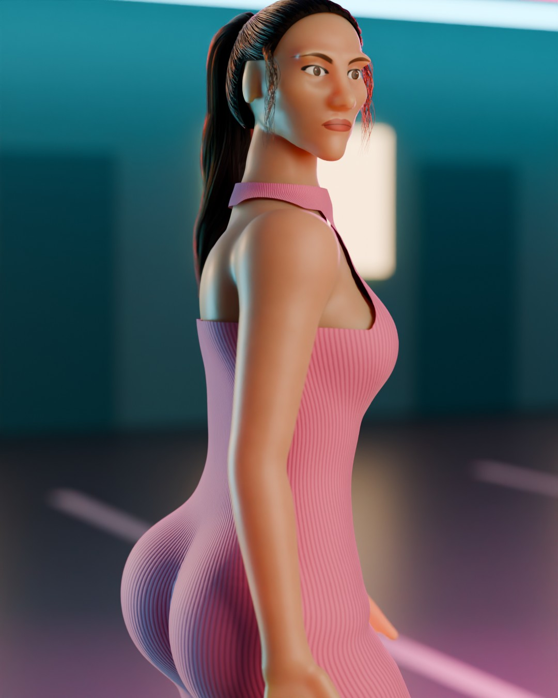
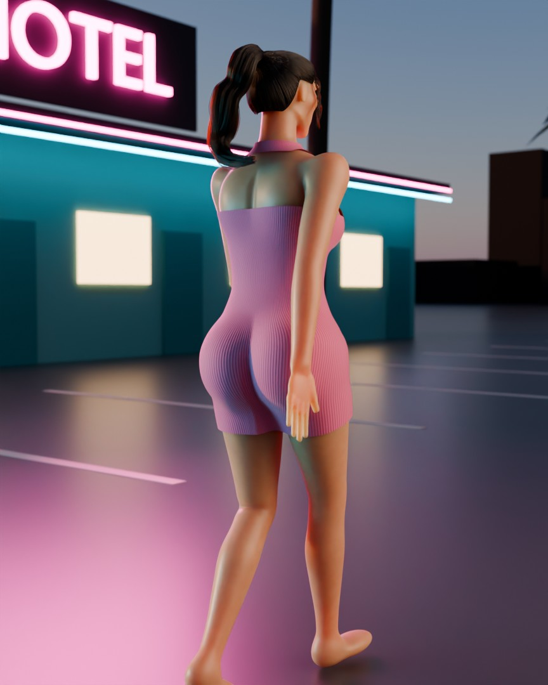

# Soft-Body Character — Blender build

`build_character.py` generates the whole scene from code: mesh, rig, hair, physics-baked
animation, materials, set, lights and cameras. Nothing is imported; the only output files
are the ones you ask for.

| Portrait still (`Cam_Portrait`) | Walk cycle frame (`Cam_Hip_ThreeQuarter`) |
| --- | --- |
|  |  |

Developed and tested on **Blender 5.3**. The script avoids version-specific APIs where it
can and should run on 4.2 LTS and later, but only 5.3 has been run.

## Run it

```bash
# open Blender with the scene built (about ten seconds at full quality)
blender --python build_character.py

# headless: save a .blend and render the hero still
blender --background --python build_character.py -- --save character.blend --render still.png
```

Options after `--`:

| Option | Default | Meaning |
| --- | --- | --- |
| `--save PATH` | – | write a compressed `.blend` |
| `--render PATH` | – | render the portrait still (Cycles; about 5 minutes on 4 CPU cores) |
| `--voxel 0.005` | 5 mm | mesh extraction cell size; smaller = denser mesh |
| `--samples 96` | 96 | Cycles samples |
| `--fast` | off | 8 mm mesh, fewer strands, half-size render — for iterating |

You can also open the file in Blender's *Scripting* tab and press **Run Script**.

## What you get

**Character** collection

- `Body`, `Dress`, `HairCap` — all-quad meshes extracted from one anatomy field (lofted
  superellipse cross-sections, Catmull-Rom interpolated, fused with smooth unions).
  Subdivision is applied at render time.
- `Hair` — a Curves object: about 6,300 strands (ponytail clumps, scalp hair combed into
  the tie, two loose face-framing locks). Its geometry is read every frame from
  `HairGuides`, a polyline mesh skinned to the rig.
- `Rig` — 17 deform bones, 9 jiggle bones (`jig_glute.L/R`, `jig_thigh.L/R`,
  `jig_chest.L/R`, `jig_core`, `jig_scap.L/R`) and a 13-bone ponytail chain.

**Actions** (all baked to keyframes, so they play in real time and export to FBX/glTF)

| Action | Length | Notes |
| --- | --- | --- |
| `Strut_Walk` | 28-frame loop | contra-lateral pelvic tilt and rotation, spine counter-rotation, leg IK |
| `Athletic_Jog` | 20-frame loop | flight phase, forward lean |
| `Idle_HipSway` | 132-frame loop | weight shift, breathing |
| `Quick_Turn_HairWhip` | 160 frames | 180° turn out and back |
| `Pose_Portrait` | 1 frame | pose used for the hero still |

Soft tissue and hair are simulated at 120 Hz while baking: each jiggle bone is an
independent spring-mass-damper (`F = -k·x - c·v - m·a_bone + heel impulse + gravity sag`)
with delayed heel-strike impulses and squash-and-stretch scale for volume preservation; the
ponytail is a 14-node Verlet chain colliding with head, neck, shoulders and back.

**Set** — sunset sky, sun lamp, magenta/cyan neon, motel with extruded neon lettering,
palms, wet asphalt, skyline.

**Cameras** — `Cam_Portrait` (85 mm, shallow depth of field), `Cam_Follow`,
`Cam_Hip_ThreeQuarter`, `Cam_Side_Profile`, `Cam_Hair_UpperBody`, and three orthographic
turnaround cameras.

## Tuning the physics

Edit `PHYS` at the top of the script (`k` stiffness, `c` damping, `bounce` heel-strike
multiplier, `wind`, `sway`) and re-run. Per-zone settings are in `ZONE_PARAMS`.

## Physics heatmap

- Select `Body` or `Dress`, enter **Weight Paint** mode and pick the `jiggle_weight`
  vertex group: Blender shows the blue→red deformation map over the wireframe.
- Or enable the hidden `Diagnostic_PhysicsHeatmap` collection (and hide `Body` / `Dress`):
  the same meshes with a heatmap material and wire overlay.

## Limits

- The head is sculpted from anatomical masses (cranium, jaw, cheekbones, nose, lips) with
  painted eyes, brows and lips; there are no modelled eyelids, teeth, or facial and finger
  bones, and the ears are simple forms.
- Mesh topology is a uniform voxel-aligned quad grid, not hand-authored edge loops.
- Physics is baked, not live: change parameters, then re-run the script.
- The dress pattern (hem, halter neckline) is cut with shader alpha, so the cloth has no
  modelled thickness.
